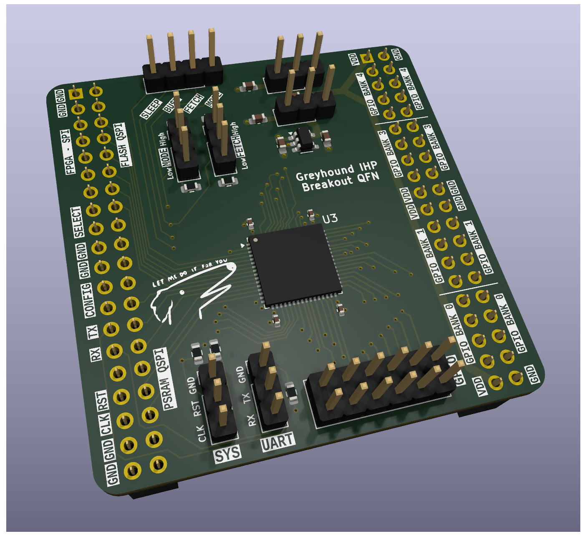

# Greyhound Breakout PCB

This repository holds the breakout PCB for [Greyhound](https://github.com/mole99/greyhound-ihp) (v1 and v2).

- `greyhound_v1/` was designed for [Greyhound v1](https://github.com/mole99/greyhound-ihp-v1) taped out on 07 Apr 2025, SG13G2.
- `greyhound_v2/` was designed for [Greyhound v2](https://github.com/mole99/greyhound-ihp-v2) taped out on 14 Sep 2025, SG13CMOS.

> [!NOTE]
> Normally, Greyhound v1 and v2 are pin compatible (and they are), but swissbit made a mistake during packaging which shifted all the bonds by one 🤦‍♂️
> See [greyhound_v2_xray](img/greyhound_v2_xray.jpg).

It is based on the [Tiny Tapeout breakout](https://github.com/TinyTapeout/breakout-pcb) board. Thanks a lot!

The PCB was designed with KiCad version 9.0.

Check out the project in your browser using KiCanvas: [Greyhound Breakout PCB](https://kicanvas.org/?github=https://github.com/mole99/greyhound-breakout-pcb/blob/main/breakout-qfn.kicad_pro)

# License

The PCB is licensed under the Apache 2 License
